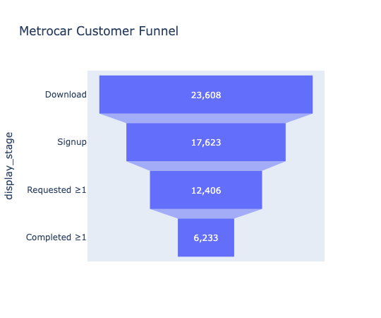
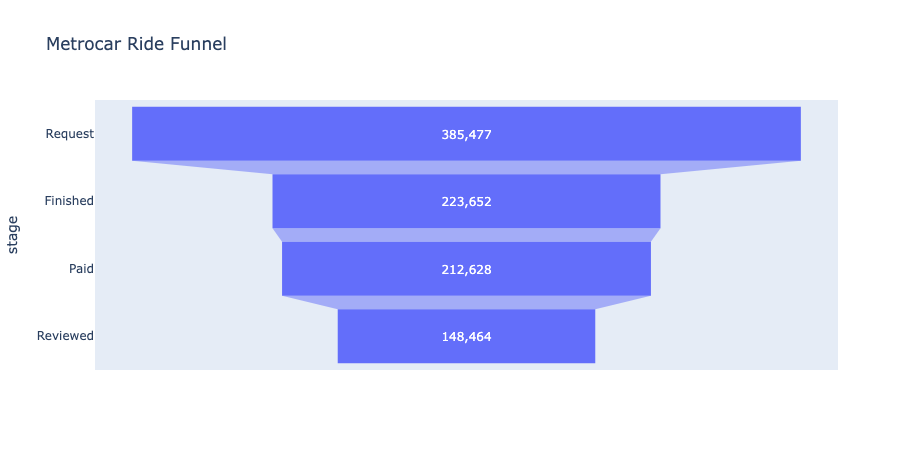
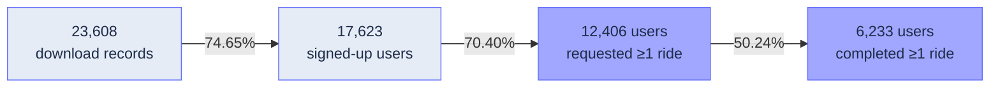
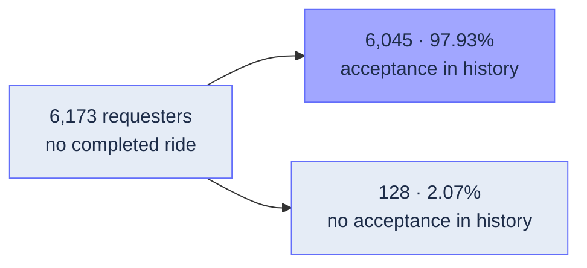

# Metrocar — Funnel Analysis

**Where do we lose momentum?**

An educational MasterSchool ride-sharing case study.

<table width="100%">
  <tr>
    <td width="32%" align="center" valign="middle">
      <a href="assets/metrocar-cover.jpeg"></a>
    </td>
    <td width="25%" align="center" valign="middle">
      <a href="assets/metrocar-customer-funnel.png"></a>
    </td>
    <td width="43%" align="center" valign="middle">
      <a href="assets/metrocar-ride-funnel.png"></a>
    </td>
  </tr>
</table>

*Customer funnel: download records → user stages. Ride funnel: individual rides; Reviewed is within the Approved-payment path.*

**The weakest step: only 50.24% of requesting users completed at least one ride.**

**[Explore the case study →](https://metrocar-funnel-analysis.onrender.com/)** · [Python analysis](metrocar_funnel_analysis.py) · [SQL Q01–Q10](metrocar_database_questions.sql)

## Where the journey narrows



*Downloads are records, not verified unique people. User ride stages mean ≥1 ride; arrows show conversion from the previous stage.*

## What did their histories reveal?



**Insight:** “Most never received an acceptance” does not fit these recorded histories.
User history does not establish the cause of non-completion on a particular ride.

**Which same-ride operational or cancellation evidence should we examine next?**

[Findings & limits](docs/METROCAR_STORY.md) · [Web source](web/)

<details>
<summary>Reproduce and review validation</summary>

**Python 3.12 + authorized PostgreSQL access.** Data and credentials are not included.

In a virtual environment:

```bash
python -m pip install -r requirements.txt
```

Set `METROCAR_DATABASE_URL` locally; never commit credentials.
Run the [Python source](metrocar_funnel_analysis.py) cells top-to-bottom in VS Code/Jupyter and inspect the validation outputs.

Recorded validation: **20 October 2026**, checkpoint [986e278](https://github.com/zvuk1T/metrocar-funnel-analysis-rebuild/commit/986e27853d30f736137fcec64154032f79f0d929).
Checked keys, joins, preserved populations, nesting, denominators and chart values.
**SQL/pandas reconciliation: Q01–Q10 only.**

[School source brief](docs/MASTERSCHOOL_METROCAR_SOURCE_BRIEF.md) · [Learning guide](docs/HOW-WE-WORK-AND-LEARN.md)

</details>

**Python · PostgreSQL · pandas · Plotly · SQLAlchemy · Astro**
